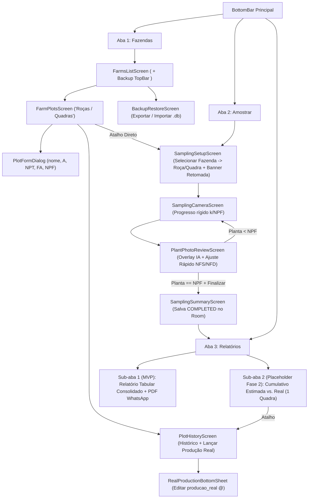

# PLAN.md — Blueprint Arquitetural & Plano de Execução (`CacaoForecastAI`)

> **Status:** Planejamento Arquitetural Congelado (Pronto para Execução via **Neon Orchestrator**)
> **Stack Alvo:** Android Nativo • Kotlin `2.0.21` • Jetpack Compose (Material 3) • Room (`SQLite` Offline-First) • CameraX `1.5.3` • TensorFlow Lite `2.16.1` • `PdfDocument` Nativo
> **Repositório de Referência Auditado (Escopo Cirúrgico):** `https://github.com/Igor8818/CacauApp.git` (`assets/`, pipeline `ObjectDetectorHelper`, `CameraUtils`, `TelaRevisaoCaptura` [fusão IoU] e `app/build.gradle.kts`)

---

## 1. Auditoria de Regras de Negócio & Melhorias Propostas

### 1.1. Produção Bruta (`NFT`) vs. Produção Líquida Comercializável (`NFS`)
- **Problema auditado:** A fórmula base `Produção (@) = ((NFT / NPF) * NPT) / FA` (onde `NFT = NFS + NFD`) mede a **carga biológica total pendente**, incluindo frutos já comprometidos por Vassoura de Bruxa, Monilíase ou Podridão Parda. Se o produtor usar `NFT` para **contratar mão de obra de colheita** ou **travar contratos futuros de venda**, terá superdimensionamento de diárias e risco real de *default* (quebra de entrega) em quadras com alta perda fitossanitária.
- **Solução pragmática:**
  - **[MVP]** Persistir sempre `n_frutos_sadios` (`NFS`) e `n_frutos_doentes` (`NFD`) separadamente e calcular/persistir **ambas** as grandezas na avaliação:
    - `producao_estimada_bruta` (base `NFT` — potencial biológico / fórmula CEPLAC original).
    - `producao_estimada_liquida` (base `NFS = ((NFS / NPF) * NPT) / FA` — safra efetivamente colhível/comercializável).
    - `perda_arrobas = producao_estimada_bruta - producao_estimada_liquida` (traduz `%` em impacto físico/financeiro direto).
  - **[MVP]** Na tela de Relatório e antes de exportar o PDF, disponibilizar um seletor rápido (`SegmentedButton`): **`Safra Líquida Sadia — NFS`** vs. **`Potencial Bruto — NFT (Fórmula CEPLAC)`**, estampando explicitamente no cabeçalho da tabela/PDF qual critério está exibido na coluna `Produção (@)`.

### 1.2. Fechamento, Queda de Bateria ou Crash na Foto `12/20` (Sessão Parcial)
- **Problema auditado:** Operar CameraX + TFLite sob sol forte aquece o aparelho e eleva o consumo de RAM; chamadas telefônicas, troca rápida para o WhatsApp ou bateria arriando no meio de uma quadra ladeira acima matam processos em memória (`ViewModel`). Perder 12 plantas já caminhadas inviabiliza a adoção em campo.
- **Solução pragmática:**
  - **[MVP]** Modelar `avaliacoes.status` como máquina de estados persistida (`IN_PROGRESS`, `COMPLETED`, `CANCELLED`) + tabela filha `amostras_planta` (`UNIQUE(avaliacao_id, indice_planta)`).
  - **[MVP]** Cada planta confirmada (`k` de `NPF`) executa `INSERT` transacional imediato no SQLite. Se o app fechar na foto `12/20`, ao reabrir o app ou selecionar a quadra, um banner oferece **"Retomar Amostragem (12/20 plantas salvas)"** ou **"Descartar Rascunho"**.
  - **[MVP]** Regra de isolamento: **somente avaliações com `status = 'COMPLETED'`** (`n_plantas_amostradas == snapshot_npf`) alimentam relatórios, histórico e consolidados.
  - **[MVP]** Gestão de espaço em disco: fotos capturadas durante `IN_PROGRESS` ficam exclusivamente em armazenamento privado (`filesDir/sessions/{avaliacaoId}/plant_{k}.jpg`, `1600x1200`, JPEG 85%, ~250 KB) e são **removidas automaticamente ao concluir ou cancelar** a sessão, mantendo apenas os contadores auditados no banco.
  - **[Fase 2]** Retenção opcional de miniaturas WebP comprimidas por avaliação para auditoria visual posterior.

### 1.3. Múltiplas Amostragens na Mesma Quadra Dentro do Mesmo Mês/Período
- **Problema auditado:** Se o técnico amostrar a mesma roça no dia `05` (pré-manejo) e no dia `25` (pós-aplicação de fungicida) dentro do mesmo mês filtrado, somar ambas as avaliações **duplica artificialmente a Área (`A`), o número de plantas (`NPT`) e a Produção (`@`)** da fazenda. Fazer média simples mistura realidades fitossanitárias distintas.
- **Solução pragmática:**
  - **[MVP]** **Regra Canônica de Deduplicação:** No Relatório Consolidado (Modo 1), para cada `quadra_id` dentro do intervalo `[inicioMillis, fimMillis]`, a query seleciona **estritamente a avaliação `COMPLETED` mais recente** (`ORDER BY data_avaliacao DESC, id DESC LIMIT 1`).
  - **[MVP]** Quando uma quadra tiver `> 1` avaliação no período filtrado, exibir indicador discreto abaixo do nome da roça (`Últ. DD/MM • N aval.`). Quadras ativas da fazenda **sem avaliação no período** não entram na soma de área/produção do rodapé (para não achatar `@/ha`), mas são listadas em aviso de cobertura no rodapé: *"Cobertura: X de Y roças avaliadas no período (Pendentes: ...)"*.
  - **[Fase 2]** Comparativo delta intra-mês ("Antes vs. Depois do Manejo") por quadra.

### 1.4. Alteração Posterior de `A`, `NPT`, `FA` ou `NPF` no Cadastro (Snapshot Histórico)
- **Problema auditado:** Replantio de falhas (`NPT`), retificação de área (`A`) por GPS ou ajuste sazonal de frutos por arroba (`FA` entre safra temporão e principal) alteram o cadastro da quadra. Um `JOIN` dinâmico reescreveria todo o passado da fazenda e invalidaria a comparação `Produção Estimada vs. Produção Real`.
- **Solução pragmática:**
  - **[MVP]** Congelar na tabela `avaliacoes` os campos `snapshot_quadra_nome`, `snapshot_area_ha`, `snapshot_npt`, `snapshot_fa` e `snapshot_npf` no instante de abertura/conclusão da amostragem. Todo relatório lê **exclusivamente** os campos `snapshot_*`.
  - **[MVP]** Exclusão segura (**Soft Delete**): `ativo = 0` em Fazendas e Quadras que já possuam avaliações vinculadas (`ON DELETE RESTRICT`), ocultando-as de novas amostragens sem destruir séries históricas.

### 1.5. Proteção Matemática (`Divisão por Zero` / `NFT == 0`) e Ponderação Exata do Consolidado
- **Problema auditado:**
  1. Em entressafra, uma quadra válida (`A > 0, NPT > 0, FA > 0, NPF >= 1`) pode legitimamente ter `NFS = 0` e `NFD = 0` (`NFT = 0`), fazendo `(NFD / NFT) * 100` gerar `NaN`.
  2. No rodapé consolidado da fazenda, calcular `SUM(NFD) / SUM(NFT)` direto das amostras brutas **está matematicamente incorreto** quando quadras têm `NPF`, `NPT` ou `FA` diferentes (daria peso maior à quadra onde tiraram mais fotos, e não à quadra com mais frutos/arrobas).
- **Solução pragmática:**
  - **[MVP]** Validação rígida de cadastro (`A > 0`, `NPT > 0`, `FA > 0`, `NPF in 1..500`) + guarda total no motor de cálculo: se `NFT == 0`, `perdas_pct = 0.0`, `producao = 0.0`, `produtividade = 0.0`.
  - **[MVP]** **Fórmulas Exatas do Consolidado da Fazenda** (sobre o conjunto deduplicado $Q$ de quadras avaliadas no período):
    - $\text{Área Total} = \sum_{i \in Q} A_i$ e $\text{Plantas Totais} = \sum_{i \in Q} \text{NPT}_i$
    - $\text{Produção Consolidada (@)} = \sum_{i \in Q} \text{Prod}_i$
    - $\text{Produtividade Consolidada (@/ha)} = \frac{\sum_{i \in Q} \text{Prod}_i}{\sum_{i \in Q} A_i}$ (se $\sum A_i > 0$, senão $0$)
    - $\text{Perdas Ponderadas (\%)} = \frac{\sum_{i \in Q} (\text{ProdBruta}_i - \text{ProdLiquida}_i)}{\sum_{i \in Q} \text{ProdBruta}_i} \times 100$ (se $\sum \text{ProdBruta}_i > 0$, senão $0$). *(Para 1 quadra, reduz-se exatamente a `(NFD / NFT) * 100`; para múltiplas quadras, pondera pelo peso real em `@` de cada roça).*

### 1.6. UX de Leitura Rápida para Ação Fitossanitária (UI + PDF no WhatsApp)
- **Solução pragmática:**
  - **[MVP]** **Ordenação padrão por `Perdas (%) DESC`** (roças críticas sempre no topo da tabela e da 1ª página do PDF), com chips na UI para alternar para `Produção (@) DESC` ou `Nome A–Z`.
  - **[MVP]** **Semáforo de Severidade nas Linhas (UI e PDF):**
    - `🟢 < 10,0%` (Controlado) • `🟡 10,0% a 19,9%` (Atenção) • `🔴 >= 20,0%` (Crítico — fundo vermelho-claro suave + texto negrito).
  - **[MVP]** **Aproveitamento Gratuito das 3 Classes de Doença do Modelo:** Como `detector_doenca.tflite` já distingue `PodridaoParda`, `Moniliase` e `VassouraBruxa`, persistir os 3 subtotais permite exibir no **Card de Destaque Executivo do PDF/UI** qual doença predomina na roça mais crítica (ex: *"🚨 Foco Prioritário: Roça Baixada — 28,4% perda [Predomínio: Vassoura de Bruxa]"*), orientando imediatamente o tipo de manejo sem alterar as 6 colunas oficiais da tabela.
  - **[MVP vs. Fase 2 na Revisão de Foto]:** No **[MVP]**, a revisão pós-captura da planta `k/NPF` prioriza velocidade em campo: exibe a foto com caixas coloridas + contadores `Sadios (NFS)` e `Doentes (NFD)` com ajuste rápido (`+ / -` ou toque simples na caixa para alternar `Sadio → Doente → Remover`) + botões `Refazer Foto` e `Confirmar Planta k/NPF`. A edição geométrica fina de arrastar 4 cantos/alças do `CacauApp` fica para **[Fase 2]**.

---

## 2. Contrato de Reaproveitamento do `CacauApp`

### 2.1. Auditoria Técnica dos Binários e Pipeline Inspecionados
Inspeção direta dos cabeçalhos FlatBuffer (`TFL3`) e do código de inferência do `CacauApp`:

| Atributo | Modelo 1: Contagem Geral (`detector.tflite`) | Modelo 2: Fitossanitário (`detector_doenca.tflite`) |
| :--- | :--- | :--- |
| **Tamanho / Runtime mín.** | `37.839.248 bytes` (~36,1 MiB) • TFLite `>= 2.9.0` | `10.511.948 bytes` (~10,0 MiB) • TFLite `>= 2.9.0` |
| **Arquitetura** | YOLOv8 Raw Transposto (`1` classe, sem *objectness*) | YOLO11n Raw Transposto (`4` classes, sem *objectness*) |
| **Tensor de Entrada `[0]`** | `inputs_0` • `[1, 640, 640, 3]` • `FLOAT32` (NHWC RGB) | `images` • `[1, 640, 640, 3]` • `FLOAT32` (NHWC RGB) |
| **Pré-processamento** | Rotação EXIF + Letterbox isomórfico `640x640` com padding `RGB(114, 114, 114)` + normalização `[0.0f, 1.0f]` (`px / 255f`) | **Idêntico** (`640x640`, padding `RGB(114, 114, 114)`, `FLOAT32` `[0.0f, 1.0f]`) |
| **Tensor de Saída `[0]`** | `Identity` • `[1, 5, 8400]` • `FLOAT32` (`[cx, cy, w, h, score_cacau]`) | `Identity` • `[1, 8, 8400]` • `FLOAT32` (`[cx, cy, w, h, c0, c1, c2, c3]`) |
| **Mapeamento de Classes** | `0 = cacau` (alto recall em tronco/copa) | Sem metadados no binário; ordem canônica fixa: `0 = PodridaoParda`, `1 = Moniliase`, `2 = Sadio`, `3 = VassouraBruxa` |
| **Thresholds & NMS** | `scoreThreshold = 0.30f` • NMS `IoU = 0.45f` | `scoreThreshold = 0.25f` • NMS multiclasse (`iouMesma = 0.45f`, `iouEntre = 0.55f`) |
| **Pós-processamento CEPEC** | Desfazimento do letterbox `(coord - pad) / scale` | + Refinamento morfocolorimétrico (`refinarClasseDoencaPorMorfologiaCor`) + Fusão IoU (`0.20f`) + fallback `classificarRecorteDoencaCacau` |

### 2.2. Mapa Cirúrgico de Cópia, Adaptação e Descarte

| Origem no `CacauApp` | Destino no `CacaoForecastAI` | Ação Cirúrgica |
| :--- | :--- | :--- |
| `app/src/main/assets/detector.tflite` | `app/src/main/assets/detector.tflite` | **Copiar binário idêntico** (`noCompress += "tflite"`). |
| `app/src/main/assets/detector_doenca.tflite` | `app/src/main/assets/detector_doenca.tflite` | **Copiar binário idêntico** (`noCompress += "tflite"`). |
| `.../userinterface/util/ObjectDetectorHelper.kt` | `.../ml/YoloTfliteInterpreter.kt` + `.../ml/CacaoColorHeuristics.kt` | **Adaptar e enxugar:** Manter decodificação YOLO `[1, 4+C, 8400]`, NMS multiclasse, `DEFAULT_4CLASS_DOENCA_LABELS`, `refinarClasseDoencaPorMorfologiaCor` e `classificarRecorteDoencaCacau`. **Remover** suporte a `.zip` externo, `SSD_POST_PROCESS`, `obb/pose`, `ImportadorPlanilhaUniversal` e `tensorflow-lite-task-vision` (`Detection`). |
| `.../userinterface/TelaRevisaoCaptura.kt` *(apenas linhas 484–609 e 736–768)* | `.../ml/DualModelFusionProcessor.kt` + `.../ml/BitmapExifLoader.kt` | **Extrair funções puras:** `fundirContagemEDiagnosticoIoU` (`iouMinimo = 0.20f`) e `carregarBitmapOrientado` (8 orientações EXIF + `inSampleSize` para `maxDim = 1600`). **Descartar** toda a UI legada e referências a `ClonesCepec`/`RotaColeta`. |
| `.../userinterface/util/CameraUtils.kt` | `.../ui/sampling/CameraPreviewBox.kt` | **Adaptar:** Manter `criarImageCaptureCacau()` (`1600x1200`, `RATIO_4_3`, JPEG `85`), pinch-to-zoom, tap-to-focus e lanterna. **Remover** escrita em `MediaStore` público (salvar apenas em `filesDir` privado) e desligar `ImageAnalysis` contínuo de preview por padrão. |
| `app/build.gradle.kts` + `proguard-rules.pro` | `app/build.gradle.kts` + `proguard-rules.pro` | **Extrair apenas dependências limpas:** `tensorflow-lite:2.16.1` (sem `task-vision`, eliminando o conflito de `support-api`), CameraX `1.5.3`, `exifinterface:1.3.7` e regras `-keep class org.tensorflow.lite.** { *; }`. **Descartar** `okhttp3` e `play-services-location`. |

### 2.3. Estratégia Anti-OOM e Performance para Sessões de `NPF` Fotos (`20..100` plantas)
No `CacauApp`, a função `executarInferenciaRevisaoSincrona` instanciava e fechava **dois novos `ObjectDetectorHelper` a cada foto capturada**, realocando buffers nativos e recompilando delegates `2 × NPF` vezes. Para eliminar `OutOfMemoryError`, aquecimento e *lag* no `CacaoForecastAI`:

1. **Ciclo de Vida `Session-Scoped` em Thread Única (`"cacao-ml-worker"`):** Os 2 `Interpreter`s são abertos **uma única vez** em `prepareSession()` (XNNPACK ativo com `(availableProcessors / 2).coerceIn(2, 4)` threads como padrão estável; zero recriação entre as fotos `1..NPF`) e liberados em `releaseSession()` ao sair do fluxo de amostragem.
2. **Pré-processamento Compartilhado Único (50% menos CPU e RAM):** Como ambos os modelos exigem exatamente `[1, 640, 640, 3] FLOAT32` com letterbox `RGB(114, 114, 114)`, o motor aloca **1 único** `letterboxBitmap` (`640x640`), **1 único** `IntArray(409_600)` e **1 único** `DirectByteBuffer` (`4.915.200 bytes` / 4,69 MiB). Para cada foto, o letterbox + normalização RGB roda **uma só vez** e alimenta sequencialmente `countInterpreter.run(sharedInputBuf, out5x8400)` → `rewind()` → `diseaseInterpreter.run(sharedInputBuf, out8x8400)`.
3. **Preview Sem Drenagem Térmica:** Durante o enquadramento entre árvores, o CameraX mantém apenas `Preview` + `ImageCapture` (`1600x1200`), sem `ImageAnalysis` contínuo disputando CPU/memória. A inferência dupla só dispara na foto estática capturada (`~220–450 ms` totais).
4. **Reciclagem Determinística de Bitmaps:** O `Bitmap` decodificado (`<= 1600px`) é usado para inferência + exibição na confirmação da planta `k/NPF` e explicitamente reciclado/liberado antes de abrir a captura da planta `k+1`, mantendo o heap de imagem abaixo de `~16 MiB` constantes mesmo em `NPF = 100`.
5. **Elevação de `maxResults`:** Elevar o limite padrão de `25` (do `CacauApp`) para **`100` detecções por foto**, evitando truncamento de contagem em cacaueiros de alta carga.

### 2.4. Contrato Kotlin Imutável do Serviço de Inferência (`FruitAnalysisEngine`)

```kotlin
package com.cacaoforecast.ai.domain.ml

import android.net.Uri

enum class FruitHealthCategory(val isDiseased: Boolean) {
    SADIO(isDiseased = false),
    PODRIDAO_PARDA(isDiseased = true),
    MONILIASE(isDiseased = true),
    VASSOURA_BRUXA(isDiseased = true)
}

data class DetectedFruitBox(
    val id: String,
    val normLeft: Float,   // [0f..1f] relativo ao bitmap orientado
    val normTop: Float,    // [0f..1f]
    val normRight: Float,  // [0f..1f]
    val normBottom: Float, // [0f..1f]
    val category: FruitHealthCategory,
    val confidence: Float,
    val isManualOverride: Boolean = false
)

data class PlantPhotoAnalysisResult(
    val boxes: List<DetectedFruitBox>,
    val countHealthy: Int,        // NFS
    val countDiseased: Int,       // NFD (soma das 3 doenças)
    val countPodridaoParda: Int,
    val countMoniliase: Int,
    val countVassouraBruxa: Int,
    val imageWidthPx: Int,
    val imageHeightPx: Int,
    val inferenceTimeMs: Long
) {
    val countTotal: Int get() = countHealthy + countDiseased // NFT
}

interface FruitAnalysisEngine {
    /** Pré-aquece os 2 modelos TFLite na thread dedicada antes da planta 1/NPF. */
    suspend fun prepareSession(): Result<Unit>

    /** Analisa uma foto capturada executando contagem + doenças + fusão IoU em passo único. */
    suspend fun analyzePhoto(
        photoUri: Uri,
        countThreshold: Float = 0.30f,
        diseaseThreshold: Float = 0.25f,
        maxResults: Int = 100
    ): Result<PlantPhotoAnalysisResult>

    /** Libera Interpreters e buffers diretos ao concluir ou sair da sessão de amostragem. */
    fun releaseSession()
}
```

---

## 3. Arquitetura e Contratos de Dados (Imutáveis para o Neon)

### 3.1. Estrutura Enxuta de Pacotes (Single-Module + Pragmatic MVVM + DI Manual)
Sem multi-módulos desnecessários e sem *annotation processing* pesado de Hilt/Dagger (apenas KSP para Room, garantindo compilação rápida e zero conflito com AGP `9.0` / Kotlin `2.0.21`):

```text
app/src/main/java/com/cacaoforecast/ai/
├── CacaoForecastApp.kt              # Application + inicialização preguiçosa do AppContainer
├── di/
│   └── AppContainer.kt              # Injeção manual limpa (Database, Repositories, Engine, Pdf, Backup)
├── data/
│   ├── local/
│   │   ├── CacaoDatabase.kt         # RoomDatabase (version = 1, exportSchema = true)
│   │   ├── entity/                  # FarmEntity, PlotEntity, EvaluationEntity, PlantSampleEntity
│   │   └── dao/                     # FarmDao, PlotDao, EvaluationDao
│   ├── repository/                  # DefaultCacaoRepository.kt
│   └── backup/                      # SqliteBackupManager.kt (WAL checkpoint + integrity_check)
├── domain/
│   ├── model/                       # Modelos puros de domínio e filtros de relatório
│   ├── calculator/                  # ForecastCalculator.kt & FarmReportConsolidator.kt (100% JVM-testable)
│   └── ml/                          # FruitAnalysisEngine.kt (interface e modelos da Seção 2.4)
├── ml/                              # Implementação TFLite portada do CacauApp
│   ├── TfliteFruitAnalysisEngine.kt
│   ├── YoloTfliteInterpreter.kt
│   ├── DualModelFusionProcessor.kt
│   ├── CacaoColorHeuristics.kt
│   └── BitmapExifLoader.kt
├── pdf/
│   ├── PdfReportGenerator.kt        # android.graphics.pdf.PdfDocument nativo + Disclaimer fixo
│   └── ReportShareHelper.kt         # FileProvider + Intent direta WhatsApp / Share Sheet
└── ui/
    ├── navigation/                  # CacaoNavGraph.kt + Routes.kt
    ├── theme/                       # Paleta rural alto contraste + semáforo fitossanitário
    ├── farms/                       # CRUD Fazendas & Roças/Quadras
    ├── sampling/                    # Setup, CameraPreviewBox, Revisão Planta k/NPF, Resumo
    ├── history/                     # Histórico da Roça + BottomSheet de Produção Real
    ├── reports/                     # Modo 1 (Tabela + PDF) e Modo 2 (Placeholder Cumulativo)
    └── backup/                      # Exportação e Importação segura do SQLite
```

### 3.2. Schema Completo do Room (`SQLite`)

```sql
-- 1. FAZENDAS
CREATE TABLE IF NOT EXISTS fazendas (
    id INTEGER PRIMARY KEY AUTOINCREMENT NOT NULL,
    nome TEXT NOT NULL,
    municipio_uf TEXT,
    proprietario TEXT,
    ativo INTEGER NOT NULL DEFAULT 1,
    criado_em INTEGER NOT NULL,
    atualizado_em INTEGER NOT NULL
);
CREATE INDEX IF NOT EXISTS idx_fazendas_ativo_nome ON fazendas(ativo, nome);

-- 2. ROÇAS / QUADRAS
CREATE TABLE IF NOT EXISTS quadras (
    id INTEGER PRIMARY KEY AUTOINCREMENT NOT NULL,
    fazenda_id INTEGER NOT NULL,
    nome TEXT NOT NULL,
    area_ha REAL NOT NULL CHECK(area_ha > 0.0),         -- A
    npt INTEGER NOT NULL CHECK(npt > 0),                -- NPT
    fa REAL NOT NULL CHECK(fa > 0.0),                   -- FA (frutos por @)
    npf INTEGER NOT NULL CHECK(npf >= 1 AND npf <= 500),-- NPF (meta de fotos)
    ativo INTEGER NOT NULL DEFAULT 1,
    criado_em INTEGER NOT NULL,
    atualizado_em INTEGER NOT NULL,
    FOREIGN KEY(fazenda_id) REFERENCES fazendas(id) ON DELETE RESTRICT
);
CREATE INDEX IF NOT EXISTS idx_quadras_fazenda_ativo ON quadras(fazenda_id, ativo, nome);

-- 3. AVALIAÇÕES DE AMOSTRAGEM (CABEÇALHO + SNAPSHOT + MÉTRICAS SELADAS)
CREATE TABLE IF NOT EXISTS avaliacoes (
    id INTEGER PRIMARY KEY AUTOINCREMENT NOT NULL,
    fazenda_id INTEGER NOT NULL,
    quadra_id INTEGER NOT NULL,
    status TEXT NOT NULL CHECK(status IN ('IN_PROGRESS', 'COMPLETED', 'CANCELLED')),
    -- Snapshot imutável dos parâmetros cadastrais vigentes na quadra
    snapshot_quadra_nome TEXT NOT NULL,
    snapshot_area_ha REAL NOT NULL,
    snapshot_npt INTEGER NOT NULL,
    snapshot_fa REAL NOT NULL,
    snapshot_npf INTEGER NOT NULL,
    -- Contagens auditadas
    n_plantas_amostradas INTEGER NOT NULL DEFAULT 0,
    n_frutos_sadios INTEGER NOT NULL DEFAULT 0,         -- NFS
    n_frutos_doentes INTEGER NOT NULL DEFAULT 0,        -- NFD
    n_podridao_parda INTEGER NOT NULL DEFAULT 0,
    n_moniliase INTEGER NOT NULL DEFAULT 0,
    n_vassoura_bruxa INTEGER NOT NULL DEFAULT 0,
    -- Métricas calculadas (persistidas ao concluir)
    producao_estimada REAL NOT NULL DEFAULT 0.0,        -- Bruta (@) base NFT (fórmula CEPLAC)
    producao_estimada_liquida REAL NOT NULL DEFAULT 0.0,-- Líquida (@) base NFS
    produtividade REAL NOT NULL DEFAULT 0.0,            -- Bruta (@/ha)
    produtividade_liquida REAL NOT NULL DEFAULT 0.0,    -- Líquida (@/ha)
    perdas_pct REAL NOT NULL DEFAULT 0.0,               -- (NFD / NFT) * 100
    -- Pós-colheita (editável posteriormente no histórico)
    producao_real REAL,                                 -- NULL inicialmente
    producao_real_em INTEGER,
    -- Controle temporal
    iniciado_em INTEGER NOT NULL,
    data INTEGER NOT NULL,                              -- Epoch millis da avaliação (filtro mensal)
    FOREIGN KEY(fazenda_id) REFERENCES fazendas(id) ON DELETE RESTRICT,
    FOREIGN KEY(quadra_id) REFERENCES quadras(id) ON DELETE RESTRICT
);
CREATE INDEX IF NOT EXISTS idx_avaliacoes_relatorio ON avaliacoes(fazenda_id, status, data DESC);
CREATE INDEX IF NOT EXISTS idx_avaliacoes_quadra_status ON avaliacoes(quadra_id, status, data DESC);

-- 4. AMOSTRAS POR PLANTA (PERSISTÊNCIA ATÔMICA 1..NPF CONTRA CRASH)
CREATE TABLE IF NOT EXISTS amostras_planta (
    id INTEGER PRIMARY KEY AUTOINCREMENT NOT NULL,
    avaliacao_id INTEGER NOT NULL,
    indice_planta INTEGER NOT NULL CHECK(indice_planta >= 1),
    n_sadios INTEGER NOT NULL CHECK(n_sadios >= 0),
    n_doentes INTEGER NOT NULL CHECK(n_doentes >= 0),
    n_podridao_parda INTEGER NOT NULL DEFAULT 0,
    n_moniliase INTEGER NOT NULL DEFAULT 0,
    n_vassoura_bruxa INTEGER NOT NULL DEFAULT 0,
    editado_manualmente INTEGER NOT NULL DEFAULT 0,
    foto_temp_path TEXT,
    capturado_em INTEGER NOT NULL,
    FOREIGN KEY(avaliacao_id) REFERENCES avaliacoes(id) ON DELETE CASCADE
);
CREATE UNIQUE INDEX IF NOT EXISTS idx_amostras_avaliacao_indice
    ON amostras_planta(avaliacao_id, indice_planta);
```

### 3.3. Query SQL de Relatório Deduplicado por Quadra + Agregação Consolidada
Compatível com SQLite `>= 3.18` (sem depender de *window functions* ausentes em Android 8/9):

```sql
-- EvaluationDao.observeLatestCompletedPerPlotInPeriod(...)
SELECT
    a.*,
    (
        SELECT COUNT(*)
        FROM avaliacoes ac
        WHERE ac.quadra_id = a.quadra_id
          AND ac.status = 'COMPLETED'
          AND ac.data BETWEEN :startMillis AND :endMillis
    ) AS qtd_avaliacoes_no_periodo
FROM avaliacoes a
WHERE a.fazenda_id = :fazendaId
  AND a.status = 'COMPLETED'
  AND a.data BETWEEN :startMillis AND :endMillis
  AND (:quadraId IS NULL OR a.quadra_id = :quadraId)
  AND a.id = (
      SELECT a2.id
      FROM avaliacoes a2
      WHERE a2.quadra_id = a.quadra_id
        AND a2.status = 'COMPLETED'
        AND a2.data BETWEEN :startMillis AND :endMillis
      ORDER BY a2.data DESC, a2.id DESC
      LIMIT 1
  )
ORDER BY a.perdas_pct DESC, a.snapshot_quadra_nome ASC;
```

A consolidação do rodapé (`FarmReportConsolidator.consolidate(rows, basis)`) opera deterministicamente sobre as linhas retornadas pela query acima, garantindo **100% de consistência entre os valores das linhas da tabela e o total do rodapé** (tanto na UI quanto no PDF).

### 3.4. Assinaturas Exatas de Domínio, Calculadoras, Repositório e UI Models

```kotlin
package com.cacaoforecast.ai.domain.model

enum class ProductionBasis { NET_HEALTHY_NFS, GROSS_TOTAL_NFT }
enum class DiseaseSeverity { CONTROLLED, WARNING, CRITICAL }
enum class DominantDisease { NONE, PODRIDAO_PARDA, MONILIASE, VASSOURA_BRUXA }
enum class ReportSortOrder { LOSS_DESC, PRODUCTION_DESC, PLOT_NAME_ASC }

data class Farm(
    val id: Long = 0L,
    val nome: String,
    val municipioUf: String? = null,
    val proprietario: String? = null,
    val ativo: Boolean = true
)

data class Plot(
    val id: Long = 0L,
    val fazendaId: Long,
    val nome: String,
    val areaHa: Double, // A > 0
    val npt: Int,       // NPT > 0
    val fa: Double,     // FA > 0
    val npf: Int = 20,  // NPF >= 1
    val ativo: Boolean = true
)

data class ComputedMetrics(
    val producaoBrutaArrobas: Double,
    val producaoLiquidaArrobas: Double,
    val produtividadeBrutaPorHa: Double,
    val produtividadeLiquidaPorHa: Double,
    val perdaArrobas: Double,
    val perdasPct: Double,
    val severity: DiseaseSeverity,
    val dominantDisease: DominantDisease
)

data class PlotReportRowUiModel(
    val evaluationId: Long,
    val plotId: Long,
    val plotName: String,
    val evaluationDateMillis: Long,
    val evaluationsCountInPeriod: Int,
    val areaHa: Double,
    val npt: Int,
    val producaoExibidaArrobas: Double,
    val produtividadeExibidaPorHa: Double,
    val producaoBrutaArrobas: Double,
    val producaoLiquidaArrobas: Double,
    val perdasPct: Double,
    val severity: DiseaseSeverity,
    val dominantDisease: DominantDisease
)

data class FarmConsolidatedFooterUiModel(
    val totalPlotsEvaluated: Int,
    val totalActivePlotsInFarm: Int,
    val pendingPlotNames: List<String>,
    val totalAreaHa: Double,
    val totalNpt: Int,
    val totalProducaoExibidaArrobas: Double,
    val produtividadeConsolidadaPorHa: Double,
    val totalPerdaArrobas: Double,
    val perdasPonderadasPct: Double,
    val severity: DiseaseSeverity
)

data class FarmReportUiModel(
    val farm: Farm,
    val periodLabel: String,
    val startMillis: Long,
    val endMillis: Long,
    val selectedPlotId: Long?, // null = todas as roças/quadras
    val basis: ProductionBasis,
    val sortOrder: ReportSortOrder,
    val criticalHighlightRow: PlotReportRowUiModel?,
    val rows: List<PlotReportRowUiModel>,
    val footer: FarmConsolidatedFooterUiModel
)
```

```kotlin
package com.cacaoforecast.ai.domain.calculator

object ForecastCalculator {
    fun calculate(
        nfs: Int,
        nfd: Int,
        nPodridao: Int = 0,
        nMoniliase: Int = 0,
        nVassoura: Int = 0,
        npf: Int,
        npt: Int,
        fa: Double,
        areaHa: Double
    ): ComputedMetrics
}

object FarmReportConsolidator {
    fun buildReport(
        farm: Farm,
        allActivePlots: List<Plot>,
        deduplicatedEvaluations: List<EvaluationWithPeriodCount>,
        periodLabel: String,
        startMillis: Long,
        endMillis: Long,
        selectedPlotId: Long?,
        basis: ProductionBasis,
        sortOrder: ReportSortOrder
    ): FarmReportUiModel
}
```

```kotlin
package com.cacaoforecast.ai.domain.repository

import kotlinx.coroutines.flow.Flow
import java.io.File

interface CacaoRepository {
    // CRUD Fazendas e Roças/Quadras
    fun observeActiveFarms(): Flow<List<Farm>>
    suspend fun saveFarm(farm: Farm): Result<Long>
    suspend fun archiveFarm(farmId: Long): Result<Unit>

    fun observeActivePlotsByFarm(farmId: Long): Flow<List<Plot>>
    suspend fun getPlotById(plotId: Long): Plot?
    suspend fun savePlot(plot: Plot): Result<Long>
    suspend fun archivePlot(plotId: Long): Result<Unit>

    // Fluxo de Amostragem Resiliente (1..NPF)
    suspend fun findInProgressSession(plotId: Long): SamplingSessionDraft?
    suspend fun findAnyInProgressSession(): SamplingSessionDraft?
    suspend fun startNewSamplingSession(plot: Plot): Result<SamplingSessionDraft>
    suspend fun savePlantSample(
        evaluationId: Long,
        plantIndex: Int,
        nfs: Int,
        nfd: Int,
        nPodridao: Int,
        nMoniliase: Int,
        nVassoura: Int,
        manualEdited: Boolean,
        tempPhotoPath: String?
    ): Result<SamplingSessionDraft>
    suspend fun finalizeSamplingSession(evaluationId: Long): Result<Long> // exige count == snapshot_npf
    suspend fun discardSamplingSession(evaluationId: Long): Result<Unit>

    // Histórico & Produção Real
    fun observeCompletedEvaluationsByPlot(plotId: Long): Flow<List<EvaluationSummary>>
    suspend fun getEvaluationById(evaluationId: Long): EvaluationSummary?
    suspend fun updateRealProduction(evaluationId: Long, realArrobas: Double?): Result<Unit>

    // Relatório Consolidado (sempre via SQLite, nunca memória volátil)
    fun observeFarmReport(
        farmId: Long,
        startMillis: Long,
        endMillis: Long,
        selectedPlotId: Long?,
        basis: ProductionBasis,
        sortOrder: ReportSortOrder
    ): Flow<FarmReportUiModel>
}
```

---

## 4. Mapa de Telas e Fluxo de Navegação

Estrutura em **Bottom Navigation de 3 abas** (botões táteis `>= 52dp`, alto contraste para leitura sob luz solar direta) + fluxo modal fullscreen para a câmera:



### Detalhamento de Estados por Tela
1. **`FarmsListScreen` & `FarmPlotsScreen`:**
   - *Empty:* CTA central *"Cadastrar Primeira Fazenda"* / *"Adicionar Roça / Quadra"*.
   - *Loaded:* Cards exibindo resumo cadastral (`A ha • NPT plantas • FA frutos/@ • Meta: NPF fotos`) + botões rápidos **`Amostrar`** e **`Histórico / Prod. Real`**.
   - *Error:* Validação inline de formulário impedindo `0`, negativos ou campos vazios.
2. **`SamplingSetupScreen` → `SamplingCameraScreen` → `PlantPhotoReviewScreen` → `SamplingSummaryScreen`:**
   - *Retomada:* Detecta `IN_PROGRESS` no banco e exibe card amarelo no topo (*"Sessão pendente na Roça X: 12/20 plantas"*).
   - *Câmera (`k/NPF`):* Indicador fixo gigante `Planta 07 de 20` + barra de progresso linear. Botão `Finalizar` inexistente até `k == NPF`. Botão `Voltar` abre confirmação (*"Salvar rascunho e sair"* vs. *"Cancelar amostragem"*).
   - *Revisão da Planta:* Loading curto (`~300ms`, *"Analisando frutos e doenças..."*) → Foto com caixas coloridas + contadores editáveis `Sadios (NFS)` / `Doentes (NFD)` + botões `Refazer Foto` e `Confirmar Planta 07/20 →` (na última foto: `Concluir Avaliação 20/20 ✓`).
   - *Erro de Câmera/Permissão:* Card explicativo para conceder permissão `CAMERA` nas configurações, sem crash.
3. **`PlotHistoryScreen` (Onde vive o lançamento da `producao_real`):**
   - Lista todas as avaliações `COMPLETED` da Roça/Quadra.
   - Avaliações com `producao_real == NULL` exibem chip destacado **`+ Informar Produção Real (@)`**. Ao tocar, abre `RealProductionBottomSheet` com teclado numérico decimal, salvando no Room e exibindo imediatamente `Estimada vs. Real (@)` e o erro relativo (`%`).
4. **`ReportsScreen` (Aba Relatórios):**
   - **Sub-aba "Consolidado (Tabela & PDF)" [MVP]:**
     - *Empty (Sem fazenda cadastrada):* Redireciona para cadastro de fazenda.
     - *Empty (Sem avaliações no período):* Exibe filtros ativos + estado vazio *"Nenhuma amostragem concluída neste período para a fazenda selecionada"*, desabilitando o botão de PDF.
     - *Loaded:* Filtros (`Fazenda`, `Mês/Período`, `Todas as Quadras | 1 Quadra`, `Base: Líquida | Bruta`) → Card de Alerta da Roça Mais Crítica → Tabela horizontalmente segura com as 6 colunas oficiais (`Roça | Área (ha) | Npla | Produção (@) | Produtividade (@/ha) | Perdas (%)`), semáforo por linha e rodapé fixo **Total / Consolidado da Fazenda** → Botão primário **`Enviar PDF no WhatsApp`** + botão secundário **`Compartilhar / Salvar PDF`**.
   - **Sub-aba "Evolução (Gráfico)" [Placeholder Fase 2]:**
     - Mantém seletores de `Fazenda` e `1 Roça/Quadra específica` já funcionais e renderiza card placeholder limpo explicando o comparativo temporal `ProdEstimada (@)` vs `ProdReal (@)`, com botão direto **`Lançar Produção Real no Histórico desta Quadra`** para incentivar a coleta de dados desde já.

---

## 5. Plano de Execução para o Neon Orchestrator (Checklist de Tarefas Atômicas)

> **Diretriz para o Neon Orchestrator:** Executar estritamente em ordem de dependência. Cada tarefa deve compilar sem erros antes de encerrar. Não expandir escopo além dos arquivos alvo listados.

### `TASK-01` — Bootstrap do Projeto Android, Dependências Limpas e Assets TFLite
- **Objetivo:** Estruturar o projeto Gradle Android single-module (`minSdk = 26`, `targetSdk = 35/36`, `compileSdk = 35/36`), configurar KSP + Room, Compose Material 3, CameraX `1.5.3`, TFLite `2.16.1` (sem `task-vision`), `noCompress += "tflite"`, `FileProvider` e copiar os 2 modelos `.tflite` oficiais do `CacauApp`.
- **Dependências:** Nenhuma.
- **Arquivos alvo:**
  - `settings.gradle.kts`, `build.gradle.kts`, `gradle.properties`, `gradle/libs.versions.toml`
  - `app/build.gradle.kts`, `app/proguard-rules.pro`
  - `app/src/main/AndroidManifest.xml`, `app/src/main/res/xml/file_paths.xml`
  - `app/src/main/assets/detector.tflite`, `app/src/main/assets/detector_doenca.tflite`
  - `app/src/main/java/com/cacaoforecast/ai/CacaoForecastApp.kt`, `MainActivity.kt`, `ui/theme/{Color,Type,Theme}.kt`
- **Critério de Aceite (DoD):** `./gradlew assembleDebug` executa com código `0`, ambos os arquivos `.tflite` estão presentes sem compressão no APK gerado e o app abre tela inicial vazia.

### `TASK-02` — Motor Matemático de Safra, Ponderação Consolidada e Testes Unitários
- **Objetivo:** Implementar os modelos de domínio puros e as calculadoras `ForecastCalculator` e `FarmReportConsolidator` com proteção total contra divisão por zero / `NFT == 0`, semáforo fitossanitário e cálculo consolidado ponderado da fazenda.
- **Dependências:** `TASK-01`.
- **Arquivos alvo:**
  - `app/src/main/java/com/cacaoforecast/ai/domain/model/{DomainModels.kt,ReportModels.kt}`
  - `app/src/main/java/com/cacaoforecast/ai/domain/calculator/{ForecastCalculator.kt,FarmReportConsolidator.kt}`
  - `app/src/test/java/com/cacaoforecast/ai/domain/calculator/{ForecastCalculatorTest.kt,FarmReportConsolidatorTest.kt}`
- **Critério de Aceite (DoD):** `./gradlew testDebugUnitTest` passa 100% cobrindo: cálculo nominal (`NFT` e `NFS`), `NFT == 0` retornando `0.0%` sem `NaN`, rejeição de `FA/A/NPF <= 0`, deduplicação e ponderação exata entre quadras heterogêneas (provando que não faz média simples).

### `TASK-03` — Persistência Room (`SQLite`), Snapshot Histórico e Repositório Core
- **Objetivo:** Implementar o banco Room completo (`fazendas`, `quadras`, `avaliacoes`, `amostras_planta`), DAOs com `CHECK`/FKs, query SQL deduplicada por período e implementação `DefaultCacaoRepository` (exceto backup).
- **Dependências:** `TASK-02`.
- **Arquivos alvo:**
  - `app/src/main/java/com/cacaoforecast/ai/data/local/CacaoDatabase.kt`
  - `app/src/main/java/com/cacaoforecast/ai/data/local/entity/{FarmEntity.kt,PlotEntity.kt,EvaluationEntity.kt,PlantSampleEntity.kt}`
  - `app/src/main/java/com/cacaoforecast/ai/data/local/dao/{FarmDao.kt,PlotDao.kt,EvaluationDao.kt}`
  - `app/src/main/java/com/cacaoforecast/ai/domain/repository/CacaoRepository.kt`
  - `app/src/main/java/com/cacaoforecast/ai/data/repository/DefaultCacaoRepository.kt`
  - `app/src/test/java/com/cacaoforecast/ai/data/repository/SnapshotAndDeduplicationTest.kt`
- **Critério de Aceite (DoD):** `./gradlew assembleDebug` e `./gradlew testDebugUnitTest` passando; testes validam que: (a) editar `A`/`NPT`/`FA` na quadra não altera `avaliacoes` passadas; (b) avaliações `IN_PROGRESS` nunca vazam para `observeFarmReport`; (c) 2 avaliações `COMPLETED` da mesma quadra no mesmo mês retornam apenas a mais recente.

### `TASK-04` — Motor de Inferência Duplo (`TfliteFruitAnalysisEngine`) Portado do `CacauApp`
- **Objetivo:** Portar e enxugar o pipeline de inferência dos 2 modelos CEPLAC com *single-thread executor*, pré-processamento `640x640` compartilhado em buffer único, NMS multiclasse, heurística morfocolorimétrica e fusão IoU (`0.20f`).
- **Dependências:** `TASK-01`.
- **Arquivos alvo:**
  - `app/src/main/java/com/cacaoforecast/ai/domain/ml/FruitAnalysisEngine.kt`
  - `app/src/main/java/com/cacaoforecast/ai/ml/{YoloTfliteInterpreter.kt,CacaoColorHeuristics.kt,DualModelFusionProcessor.kt,BitmapExifLoader.kt,TfliteFruitAnalysisEngine.kt}`
  - `app/src/test/java/com/cacaoforecast/ai/ml/{YoloDecodeAndNmsTest.kt,DualModelFusionProcessorTest.kt}`
- **Critério de Aceite (DoD):** Testes unitários passando para decodificação `[1, 5, 8400]` e `[1, 8, 8400]`, mapeamento fixo das 4 classes (`PodridaoParda`, `Moniliase`, `Sadio`, `VassouraBruxa`), NMS e fusão IoU preservando 100% dos frutos de contagem e promovendo doenças sobrepostas.

### `TASK-05` — Container DI, Navegação Base e CRUD Hierárquico (Fazendas → Roças/Quadras)
- **Objetivo:** Configurar `AppContainer`, grafo de navegação de 3 abas e telas completas de listagem/criação/edição/arquivamento de Fazendas e de "Roças / Quadras" (`nome`, `A`, `NPT`, `FA`, `NPF`).
- **Dependências:** `TASK-03`, `TASK-04`.
- **Arquivos alvo:**
  - `app/src/main/java/com/cacaoforecast/ai/di/AppContainer.kt`
  - `app/src/main/java/com/cacaoforecast/ai/ui/navigation/{Routes.kt,CacaoNavGraph.kt}`
  - `app/src/main/java/com/cacaoforecast/ai/ui/farms/{FarmsViewModel.kt,FarmsListScreen.kt,FarmPlotsScreen.kt,PlotFormDialog.kt}`
- **Critério de Aceite (DoD):** Compilação limpa; CRUD completo persistindo no SQLite; nomenclatura `"Roça / Quadra"` respeitada na UI; formulários bloqueiam valores `<= 0` com feedback claro.

### `TASK-06` — Fluxo de Amostragem em Campo (`1/NPF..NPF/NPF`), Câmera e Persistência de Sessão
- **Objetivo:** Implementar seleção Fazenda → Roça/Quadra, retomada de sessão `IN_PROGRESS`, captura CameraX em arquivo privado, revisão rápida pós-foto com overlay de caixas + ajuste `NFS`/`NFD`, trava obrigatória `NPF/NPF`, selagem `COMPLETED` no banco e limpeza dos JPEGs temporários.
- **Dependências:** `TASK-04`, `TASK-05`.
- **Arquivos alvo:**
  - `app/src/main/java/com/cacaoforecast/ai/ui/sampling/{SamplingViewModel.kt,SamplingSetupScreen.kt,CameraPreviewBox.kt,SamplingCameraScreen.kt,PlantPhotoReviewScreen.kt,SamplingSummaryScreen.kt}`
  - `app/src/test/java/com/cacaoforecast/ai/ui/sampling/SamplingSessionStateTest.kt`
- **Critério de Aceite (DoD):** Testes de estado comprovam bloqueio de finalização antes de `NPF/NPF`, retomada exata na planta `k+1` após reinicialização simulada, gravação de `COMPLETED` no Room antes de exibir o resumo e remoção de fotos temporárias ao encerrar.

### `TASK-07` — Histórico da Roça/Quadra, Edição de `Produção Real` e Placeholder Modo 2
- **Objetivo:** Implementar a tela de histórico de avaliações por quadra com lançamento/edição posterior de `producao_real` (`BottomSheet` numérico) + sub-aba estruturada do Relatório Cumulativo (Modo 2) com placeholder limpo para Fase 2.
- **Dependências:** `TASK-05`.
- **Arquivos alvo:**
  - `app/src/main/java/com/cacaoforecast/ai/ui/history/{PlotHistoryViewModel.kt,PlotHistoryScreen.kt,RealProductionBottomSheet.kt}`
  - `app/src/main/java/com/cacaoforecast/ai/ui/reports/CumulativePlaceholderContent.kt`
- **Critério de Aceite (DoD):** Usuário visualiza avaliações passadas da quadra, salva/edita `producao_real` (persistindo no SQLite e atualizando o comparativo `Estimada vs. Real` em tempo real) e navega sem erros pelo placeholder do Modo 2.

### `TASK-08` — Tela de Relatório Tabular Consolidado da Fazenda (Modo 1)
- **Objetivo:** Construir a tela principal de análise filtrada da base local (Fazenda obrigatória, seletor de Mês/Período, Todas/1 Quadra, toggle Líquida/Bruta), com card de foco fitossanitário, tabela de 6 colunas ordenável por maior perda, semáforo visual e rodapé consolidado ponderado.
- **Dependências:** `TASK-03`, `TASK-05`, `TASK-07`.
- **Arquivos alvo:**
  - `app/src/main/java/com/cacaoforecast/ai/ui/reports/{FarmReportViewModel.kt,ReportsHubScreen.kt,TabularReportContent.kt,PeriodPickerDialog.kt}`
- **Critério de Aceite (DoD):** Tela renderiza dados 100% vindos do `Flow` do Room; rodapé recalcula produtividade consolidada e `%` de perda ponderada (jamais média simples); roças críticas ficam destacadas no topo por padrão.

### `TASK-09` — Geração de PDF Local Multi-Página + Compartilhamento Direto via WhatsApp
- **Objetivo:** Implementar `PdfReportGenerator` nativo (`PdfDocument`) renderizando cabeçalho institucional/fazenda/período, card de alerta de doença, tabela de 6 colunas com destaque visual nas linhas críticas, rodapé consolidado e o **Disclaimer obrigatório em todas as páginas**, integrado ao WhatsApp via `FileProvider`.
- **Dependências:** `TASK-08`.
- **Arquivos alvo:**
  - `app/src/main/java/com/cacaoforecast/ai/pdf/{PdfReportGenerator.kt,ReportShareHelper.kt}`
  - `app/src/test/java/com/cacaoforecast/ai/pdf/PdfPaginationMathTest.kt`
- **Critério de Aceite (DoD):** PDF válido gerado offline em `cacheDir/reports/` suportando paginação automática (>25 quadras sem cortar linhas), contendo texto literal *"Disclaimer: Aplicativo em desenvolvimento. Não nos responsabilizamos pelos resultados."* no rodapé fixo; botão WhatsApp abre `com.whatsapp` / `com.whatsapp.w4b` (com fallback automático para Share Sheet padrão do Android se o WhatsApp não estiver instalado).

### `TASK-10` — Backup/Importação Segura do SQLite + Hardening de Release
- **Objetivo:** Implementar exportação (`PRAGMA wal_checkpoint(FULL)` → SAF / Share Sheet) e importação validada (`PRAGMA integrity_check` + checagem de tabelas/`user_version` + rollback automático se falhar) da base SQLite, além de validação final do build `assembleRelease` com R8.
- **Dependências:** `TASK-03`, `TASK-05`, `TASK-09`.
- **Arquivos alvo:**
  - `app/src/main/java/com/cacaoforecast/ai/data/backup/SqliteBackupManager.kt`
  - `app/src/main/java/com/cacaoforecast/ai/ui/backup/{BackupViewModel.kt,BackupRestoreScreen.kt}`
  - `app/proguard-rules.pro` *(revisão final para Room, TFLite e modelos)*
- **Critério de Aceite (DoD):** Exportação gera arquivo `.db` íntegro compartilhável; importação restaura todos os dados após reabrir conexão Room e rejeita arquivos inválidos/corrompidos sem perder a base atual; `./gradlew assembleRelease` e `./gradlew testDebugUnitTest` executam com código `0`.

---

## 6. Riscos Técnicos e Pontos de Validação com o Pesquisador

Confirmar rapidamente estes **5 pontos** com o pesquisador da CEPLAC (nenhum deles bloqueia o início das `TASK-01` a `TASK-04`, pois já estão parametrizados na arquitetura):

1. **Coluna `Produção (@)` Padrão no PDF Enviado ao Produtor (`NFT` Bruta vs. `NFS` Líquida):** Para comercialização antecipada e contratação de colheita, o pesquisador prefere que o relatório abra por padrão exibindo a **Safra Líquida Sadia (`NFS`)** ou o **Potencial Bruto (`NFT`)** da fórmula original (mantendo a outra opção no seletor)?
2. **Ponderação da `% de Perda` no Consolidado quando `FA` varia entre Quadras:** Em fazendas com clones de tamanhos diferentes (ex: CCN-51 com `FA = 220` vs. comum com `FA = 300`), a perda consolidada do rodapé deve refletir a **perda física/comercial em arrobas** (`Σ Arrobas Perdidas / Σ Arrobas Brutas`, adotada neste plano) ou a **incidência biológica em número de frutos** (`Σ Frutos Doentes Estimados / Σ Frutos Totais Estimados`)?
3. **Limiares Agronômicos do Semáforo de Doenças (`Perdas %`):** As faixas propostas (`< 10%` Controlado, `10%–20%` Atenção, `>= 20%` Crítico) estão adequadas para a realidade da CEPLAC, e a detecção de **1 único fruto com suspeita de Monilíase** deve disparar um alerta fitossanitário específico no relatório (por se tratar de praga quarentenária)?
4. **Limite de Frutos por Foto (`maxResults`) e Protocolo de Captura por Planta:** No `CacauApp`, o detector cortava em `maxResultados = 25` frutos por foto. Podemos elevar oficialmente para **`100` frutos/foto**, e cada passo `1/NPF` corresponde sempre a **1 única foto padronizada do tronco/copa baixa** por cacaueiro?
5. **Fator de Oclusão Visual (Lado Oposto do Tronco / Copa Alta):** A fórmula `((NFT / NPF) * NPT) / FA` assume diretamente os frutos visíveis em 1 foto como estimador direto da árvore, ou a metodologia de campo da CEPLAC prevê distância/enquadramento específico (ou constante de correção de visibilidade) que deva constar como instrução rápida na tela da câmera?
