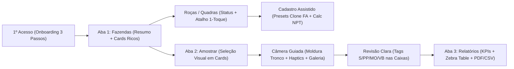

# PLAN_UI_UX_BRAND.md — Blueprint de Rebranding, Design System & Intuitividade em Campo (`CacauLens`)

> **Status:** Planejamento de UI/UX & Marca Congelado (Marca Oficial: **`CacauLens`**)
> **Base Funcional Auditada:** `PLAN.md` (`TASK-01` a `TASK-10` concluídas • `51` testes unitários passando em `12` suítes)
> **Foco desta Fase:** Substituir o nome provisório `CacaoForecastAI` pela marca **`CacauLens`**, eliminar o aspecto de "formulário técnico genérico", criar ícone adaptativo oficial e elevar a intuitividade para produtores e técnicos sob sol forte e operação com uma mão.

---

## 1. Estratégia de Rebranding & Identidade de Marca

### 1.1. Diagnóstico do Nome Atual (`CacaoForecastAI`)
- **Problemas identificados:**
  1. **Genérico e artificial:** sufixo `"AI"` em inglês soa como protótipo de hackathon e não gera vínculo imediato com cacauicultores, cooperativas ou pesquisadores da CEPLAC.
  2. **Truncamento no Android Launcher:** com 15 caracteres sem espaço, o rótulo corta na gaveta de aplicativos (`CacaoForec...`).
  3. **Ausência total de ícone (`ic_launcher`):** hoje o `AndroidManifest.xml` não declara `android:icon` nem `android:roundIcon`, exibindo o ícone padrão genérico do Android no celular.

### 1.2. Nova Marca Oficial Adotada: **`CacauLens`**

| Atributo | Definição Oficial |
| :--- | :--- |
| **Nome de Exibição** | **`CacauLens`** *(9 letras — nunca trunca no launcher Android)* |
| **Subtítulo Institucional** | *Previsão de Safra & Sanidade Offline* |
| **Slug de Arquivos** | `cacaulens` *(ex.: `cacaulens_fazenda_...pdf` / `.csv`)* |
| **Conceito do Ícone** | Fruto de cacau dourado (`#F4B400`) enquadrado por cantoneiras de lente/visão computacional sobre verde floresta profundo (`#14452B`), formando família visual com `CacauSync` e `BreedAI`. |

### 1.3. Regra de Ouro de Compatibilidade (Zero Quebra Técnica)
Para **não quebrar** atualizações sobre APKs já instalados, backups `.db` existentes, `FileProvider` ou os 51 testes unitários:
- **NÃO ALTERAR:**
  - `namespace = "com.cacaoforecast.ai"` e `applicationId = "com.cacaoforecast.ai"` em `app/build.gradle.kts`
  - Estrutura de pacotes Kotlin (`com.cacaoforecast.ai.*`)
  - Nome do banco SQLite (`CacaoDatabase.DB_NAME = "cacao_forecast.db"`) e `identityHash` do Room (`version = 1`)
  - Texto literal obrigatório da constante `PdfReportGenerator.DISCLAIMER_TEXT`
- **ATUALIZAR 100% DA CAMADA VISÍVEL:**
  - `res/values/strings.xml` (`app_name = "CacauLens"`)
  - Objeto central `BrandIdentity.kt` (`NAME = "CacauLens"`, `TAGLINE = "Previsão de Safra & Sanidade"`, `PDF_REPORT_TITLE`, `FILE_SLUG_PREFIX = "cacaulens"`)
  - Adaptive Icon vetorial Android (`mipmap-anydpi-v26/ic_launcher.xml` + `ic_launcher_round.xml` + `drawable/ic_launcher_foreground.xml` + `ic_launcher_background.xml` + `ic_launcher_monochrome.xml` para Android 13+)
  - Cabeçalhos de `TopAppBar`, `PdfReportGenerator`, `CsvReportExporter` e legendas de compartilhamento no WhatsApp.

---

## 2. Novo Design System: *"Agritech Tropical de Alto Contraste"*

### 2.1. Problemas Visuais Atuais Auditados no Código
1. **Baixa separação de cartões sob luz solar direta:** sombras sutis (`defaultElevation = 2.dp`) desaparecem sob sol forte na roça; cartões brancos sobre fundo claro parecem blocos chapados sem contorno.
2. **Barra de status desconectada:** `themes.xml` usa `Theme.Material.Light.NoActionBar` puro sem `StatusBar` coordenada com o verde da `TopAppBar`.
3. **Números desalinhados em tabelas e contadores:** `Type.kt` não ativa `fontFeatureSettings = "tnum"` (*tabular numerals*), fazendo dígitos pularem ao incrementar `+ / -` e desalinhando decimais nas colunas de `@` e `%`.
4. **Excesso de caixas cinzas (`surfaceVariant`) idênticas:** quase todos os avisos, cards secundários e contadores usam o mesmo `MaterialTheme.colorScheme.surfaceVariant` sem hierarquia visual entre *Informação*, *Ação Primária* e *Alerta*.

### 2.2. Paleta de Cores, Bordas Solares e Tipografia (`ui/theme/`)

```kotlin
// Color.kt — Tokens Semânticos Refinados (Contraste WCAG AAA sob luz solar)
val CacaoForestPrimary      = Color(0xFF14452B) // Verde folha madura profundo (TopBar, CTAs primários)
val CacaoForestOnPrimary    = Color(0xFFFFFFFF)
val CacaoForestContainer    = Color(0xFFD3ECDC) // Chips selecionados / badges ativos
val CacaoForestOnContainer  = Color(0xFF082615)

val CacaoGoldAccent         = Color(0xFFC67D0A) // Cacau maduro / ouro (destaques de arrobas @, foco câmera)
val CacaoGoldContainer      = Color(0xFFFFF0D4)
val CacaoGoldOnContainer    = Color(0xFF3E2400)

val CacaoPodSecondary       = Color(0xFF6E3F19) // Amêndoa torrada (ações secundárias)
val CacaoSurfaceLight       = Color(0xFFF4F6F2) // Fundo pergaminho suave (reduz reflexo solar vs. branco puro)
val CacaoSurfaceCard        = Color(0xFFFFFFFF) // Card elevado com borda nítida 1.dp
val CacaoCardBorder         = Color(0xFFD5DDD6) // Borda estrutural visível sob sol forte
val CacaoZebraRow           = Color(0xFFF8FAF7) // Listras alternadas na tabela de relatório
```

- **Tipografia Numérica Tabular (`Type.kt`):** Adicionar estilos utilitários ou `fontFeatureSettings = "tnum"` em `headlineMedium`, `titleLarge`, `titleMedium` e `bodyMedium` para alinhamento milimétrico de `@`, `@/ha` e `%`.
- **Geometria (`Shape.kt`):** `Small = 10.dp` (chips/badges), `Medium = 14.dp` (cards com `BorderStroke(1.dp, CacaoCardBorder)`), `Large = 22.dp` (painéis inferiores e modais).

### 2.3. Biblioteca Enxuta de Componentes Visuais (`ui/components/`)
Criar componentes padronizados e reutilizáveis para eliminar repetição e dar acabamento profissional em todas as telas:
1. **`BrandTopAppBar.kt`:** TopBar unificada com título forte, subtítulo contextual opcional (ex.: nome da fazenda/roça), navegação de volta com área de toque `48dp` e ações padronizadas.
2. **`SolarCard.kt`:** Wrapper de `Card` com fundo branco (`CacaoSurfaceCard`), `RoundedCornerShape(14.dp)` e `BorderStroke(1.dp, CacaoCardBorder)` (garante contraste perfeito mesmo sob sol do meio-dia).
3. **`KpiStatCard.kt`:** Card compacto de indicador executivo (ícone + rótulo curto + valor grande `tnum` + subtexto/tendência).
4. **`SeverityPill.kt`:** Badge acessível que combina **ícone/ponto geométrico + texto + cor** (`● Controlado`, `▲ Atenção`, `◆ Crítico`) — nunca dependendo apenas de cor para daltônicos.
5. **`GlossaryHelpSheet.kt`:** `ModalBottomSheet` rápido acionado pelo botão `?` em qualquer tela de cadastro/relatório explicando em linguagem de produtor rural:
   - **Roça / Quadra:** subdivisão/talhão homogêneo da fazenda (por clone, idade ou relevo).
   - **NPT (Total de Plantas):** quantos cacaueiros produtivos existem naquela roça.
   - **FA (Frutos por Arroba):** quantos frutos sadios rendem `1 @` (15 kg) de amêndoa seca (ex.: `CCN-51 ≈ 220`, `Clones CEPEC ≈ 250`, `Comum ≈ 280–300`).
   - **NPF (Meta de Fotos):** quantas árvores serão fotografadas como amostra representativa da roça (padrão recomendado: `20` plantas bem distribuídas em zigue-zague).
   - **Safra Líquida (`NFS`) vs. Potencial Bruto (`NFT`):** o que realmente vai para o cocho/venda vs. carga total na árvore contando frutos doentes.

---

## 3. Reformulação de UX & Intuitividade Tela a Tela



### 3.1. Onboarding de Primeiro Uso (Zero Atrito, 15 Segundos)
- **Problema atual:** abrir o app pela primeira vez cai numa tela vazia pedindo cadastro sem explicar a lógica da metodologia.
- **Solução (`OnboardingWelcomeCard` ou modal único controlado por `SharedPreferences`):**
  - Exibido apenas enquanto não houver fazendas cadastradas (ou reabrível pelo botão `?`): mostra visualmente os **3 passos do `CacauLens`**:
    1. **Divida sua Fazenda em Roças** *(informe área e plantas com ajuda de presets de clone)*.
    2. **Caminhe e Fotografe `NPF` Cacaueiros** *(a IA conta frutos sadios e identifica 3 doenças sem internet)*.
    3. **Receba a Previsão em `@` e Envie o PDF no WhatsApp** *(acompanhe perdas e compare com o colhido depois)*.

### 3.2. Aba 1 — Fazendas & Divisão em Roças (`FarmsListScreen`, `FarmPlotsScreen`, `PlotFormDialog`)
- **`FarmsListScreen`:**
  - Adicionar botão `?` (Guia Rápido / Glossário) ao lado do ícone de Backup na `TopAppBar`.
  - Enriquecer cada Card de Fazenda exibindo um **resumo vivo** (via `Flow` leve ou agregação simples de quadras ativas): ex. `4 roças ativas • 12,0 ha totais` + botão direto **`Ver Roças`** evidente.
- **`FarmPlotsScreen` (Onde a fazenda é repartida em áreas):**
  - Exibir no topo uma faixa resumo da fazenda: `Total Cadastrado: X roças • Y,YY ha • Z plantas`.
  - Em cada Card de Roça/Quadra, organizar os parâmetros em **pílulas visuais escaneáveis** (`4,50 ha` | `4.500 pés` | `FA 220` | `Amostra: 20 fotos`) em vez de uma linha corrida longa.
- **`PlotFormDialog` / Tela de Cadastro Assistido (Grande salto de intuitividade!):**
  - **Presets de Clone em 1 Toque para `FA`:** abaixo do campo `FA (Frutos/@)`, adicionar chips clicáveis:
    - `CCN-51 (220)` • `PS-1319 / Clonal (250)` • `Comum / Pará (290)`
    *(Tocar num chip preenche `FA` na hora, continuando 100% editável manualmente).*
  - **Calculadora Assistida Opcional de `NPT` por Espaçamento:** botão expansível *"Não sabe o total exato de plantas? Estimar pelo espaçamento"*:
    - Com a `Área (ha)` preenchida, oferece 3 chips rápidos: `3×3m (1.111/ha)`, `3×2,5m (1.333/ha)`, `Cabruca ~650/ha` → preenche `NPT = round(areaHa * densidade)` automaticamente!
  - **Presets rápidos de `NPF`:** chips `Rápida (10)` • `Padrão CEPLAC (20)` • `Detalhada (30)`.

### 3.3. Aba 2 — Seleção de Área, Câmera Guiada & Revisão (`Sampling*Screen`)
- **`SamplingSetupScreen`:**
  - Substituir o segundo dropdown escondido de Roças por **Cards Selecionáveis Visuais das Roças da Fazenda** (com borda verde espessa `2.dp` e ícone `CheckCircle` na roça selecionada), permitindo trocar de área com **1 único toque** sem abrir menu suspenso!
  - Adicionar **Dica de Caminhamento em Campo** compacta antes do botão Iniciar: *"Caminhe em zigue-zague pela roça e tire 1 foto frontal do tronco/copa baixa (~1,5 m) de cada árvore sorteada."*
- **`SamplingCameraScreen`:**
  - **Moldura Guia de Enquadramento (`FramingReticleOverlay`):** desenhar cantoneiras leves semitransparentes no centro do visor indicando a zona ideal do tronco/frutos, sem obstruir a visão.
  - **Seletor de Zoom com Estado Ativo:** destacar claramente o nível de zoom atual (`1x`, `2x`, `3x`) com fundo preenchido dourado/branco no botão ativo.
  - **Feedback Tátil (`LocalHapticFeedback`):** vibração curta confirmatória ao disparar foto e ao confirmar cada planta (`1/NPF .. NPF/NPF`).
- **`PlantPhotoReviewScreen`:**
  - **Etiquetas Acessíveis nas Caixas (`DetectionOverlayCanvas`):** além da cor da borda (`3.dp`), desenhar um preenchimento suave (`alpha = 0.12f`) e uma mini-etiqueta legível no canto superior esquerdo de cada caixa (`S` = Sadio, `PP` = Podridão Parda, `MO` = Monilíase, `VB` = Vassoura de Bruxa), garantindo leitura imediata sob sol forte e para daltônicos.
  - Adicionar toggle rápido no topo da imagem (**`Mostrar/Ocultar Caixas`** — ícone de olho `Visibility`), permitindo inspecionar o fruto cru por baixo da marcação quando houver dúvida!
  - Painel inferior com cantos superiores arredondados (`20.dp`), sombra sutil e espaçamento compacto para que a foto ocupe **>= 58% da altura da tela** mesmo em aparelhos menores.

### 3.4. Aba 3 — Relatórios Executivos & Identidade do PDF (`Reports*`)
- **`TabularReportContent`:**
  - **Faixa de 3 KPIs Executivos no Topo** (logo após os filtros e alertas, antes da tabela):
    1. **Safra Estimada:** `XXX,X @` *(com subtítulo Líquida NFS ou Bruta NFT)*
    2. **Produtividade:** `XX,X @/ha` *(sobre `Y,YY ha` avaliados)*
    3. **Perda Ponderada:** `XX,X%` *(com `SeverityPill` + perda física `-XX,X @`)*
  - **Tabela de 6 Colunas Aprimorada:**
    - Listras alternadas (`CacaoZebraRow`) nas linhas controladas e fundo colorido suave nas linhas em atenção/críticas;
    - Indicador discreto `↔ Deslize a tabela lateralmente para ver todas as colunas` quando a largura da tela for menor que a tabela;
    - Toque em uma linha da tabela navega opcionalmente para o **Histórico daquela Roça** (drill-down intuitivo: viu que a *Roça Baixada* está com 22,5% de perda na tabela → tocou nela → abriu o histórico detalhado daquela área!).
  - **Barra de Exportação Mais Limpa:**
    - Botão principal cheio (`54.dp`, verde primário): **`Enviar Relatório PDF no WhatsApp`**
    - Linha inferior dividida meio a meio (`Row` com 2 `OutlinedButton` de `50.dp`): **`Salvar / Outros (PDF)`** | **`Planilha (.csv)`**.
- **`PdfReportGenerator`:**
  - Atualizar cabeçalho institucional para **`CacauLens • Relatório Consolidado de Safra`**, mantendo todas as 6 colunas, alertas (Foco Prioritário + Monilíase), paginação matemática exata e o texto literal imutável de `DISCLAIMER_TEXT` em todas as páginas.

---

## 4. Diretrizes Rígidas de Segurança para o Orchestrator (Invariantes)

1. **Proibido alterar contratos de dados ou cálculos testados:** `ForecastCalculator`, `FarmReportConsolidator`, `CumulativeStatsCalculator`, `CacaoDatabase`, entidades Room, DAOs, `DefaultCacaoRepository` e pipeline `ml/*` **não devem sofrer alterações de regra de negócio**.
2. **Preservação integral de strings auditadas por testes unitários existentes:**
   - `PdfReportGenerator.DISCLAIMER_TEXT` deve permanecer **exatamente**: `"Disclaimer: Aplicativo em desenvolvimento. Não nos responsabilizamos pelos resultados."`
   - Os textos verificados em `PdfPaginationMathTest` (`"Safra Líquida Sadia — NFS"`, `"Foco Fitossanitário Prioritário"`, `"ALERTA QUARENTENÁRIO"`, `"Monilíase"`, `"Roça"`, `"Área (ha)"`, `"Npla"`, `"Prod. (@)"`, `"Produt. (@/ha)"`, `"Perdas (%)"`, `"TOTAL / CONSOLIDADO"`) devem ser **mantidos intactos** no PDF!
3. **Zero dependências externas novas:** usar estritamente Material 3, `material-icons-extended` e `Canvas` nativo já configurados em `libs.versions.toml` (mantém o APK enxuto, build offline-friendly e R8 sem surpresas).
4. **Critério global de encerramento:** `./gradlew testDebugUnitTest assembleDebug assembleRelease` deve terminar com `BUILD SUCCESSFUL` e código `0` ao final de cada tarefa.

---

## 5. Plano de Execução para o Orchestrator (Tarefas Atômicas)

> **Instrução ao Orchestrator:** Executar na ordem `UI-TASK-01` → `UI-TASK-08`. Compilar (`assembleDebug` / `testDebugUnitTest`) ao concluir cada bloco antes de avançar ao próximo.

### `UI-TASK-01` — Identidade de Marca (`CacauLens`), Adaptive Icon Oficial & Edge-to-Edge
- **Objetivo:** Substituir o rótulo genérico por `CacauLens`, criar `BrandIdentity.kt`, adicionar o ícone adaptativo oficial do Android (com suporte a ícone redondo e monocromático Android 13+) e harmonizar a StatusBar com o tema.
- **Dependências:** Nenhuma.
- **Arquivos alvo:**
  - `app/src/main/java/com/cacaoforecast/ai/ui/theme/BrandIdentity.kt` *(novo)*
  - `app/src/main/res/values/strings.xml`, `app/src/main/res/values/themes.xml`
  - `app/src/main/res/drawable/ic_launcher_background.xml` *(novo — verde floresta `#14452B` com textura geométrica sutil)*
  - `app/src/main/res/drawable/ic_launcher_foreground.xml` *(novo — vector drawable nítido de fruto de cacau dourado `#F4B400` com nervuras e cantoneiras sutis de visão computacional)*
  - `app/src/main/res/drawable/ic_launcher_monochrome.xml` *(novo)*
  - `app/src/main/res/mipmap-anydpi-v26/ic_launcher.xml` e `ic_launcher_round.xml` *(novos)*
  - `app/src/main/AndroidManifest.xml` *(adicionar `android:icon="@mipmap/ic_launcher"` e `android:roundIcon="@mipmap/ic_launcher_round"`)*
  - `app/src/main/java/com/cacaoforecast/ai/MainActivity.kt` *(configurar StatusBar escura/coordenada)*
- **Critério de Aceite (DoD):** `./gradlew assembleDebug` passa com `0`; APK possui ícone adaptativo próprio e nome `CacauLens` sem alterar `applicationId`.

### `UI-TASK-02` — Design System "Agritech Tropical", Tipografia Tabular & Componentes Base
- **Objetivo:** Atualizar paleta solar de alto contraste, tipografia com dígitos tabulares (`tnum`), `Shape.kt` e criar os componentes compartilhados em `ui/components/`.
- **Dependências:** `UI-TASK-01`.
- **Arquivos alvo:**
  - `app/src/main/java/com/cacaoforecast/ai/ui/theme/{Color.kt,Type.kt,Shape.kt,Theme.kt}`
  - `app/src/main/java/com/cacaoforecast/ai/ui/components/{BrandTopAppBar.kt,SolarCard.kt,KpiStatCard.kt,SeverityPill.kt}` *(novos)*
- **Critério de Aceite (DoD):** Compilação limpa; `CacaoForecastTheme` injeta `shapes`, `typography` tabular e `colorScheme` refinado sem quebrar nenhuma tela existente.

### `UI-TASK-03` — Onboarding de 3 Passos & Glossário Agronômico Interativo (`?`)
- **Objetivo:** Tornar o app autoexplicativo para qualquer produtor ou técnico no primeiro uso, desmistificando `NPT`, `FA`, `NPF`, `NFS` e `NFT`.
- **Dependências:** `UI-TASK-02`.
- **Arquivos alvo:**
  - `app/src/main/java/com/cacaoforecast/ai/ui/components/{GlossaryHelpSheet.kt,OnboardingWelcomeCard.kt}` *(novos)*
  - `app/src/main/java/com/cacaoforecast/ai/ui/navigation/CacaoNavGraph.kt` *(refinar BottomBar com ícones filled/outlined selecionados e rótulos claros)*
- **Critério de Aceite (DoD):** Botão `?` abre `GlossaryHelpSheet` claro e legível; estado inicial guia o usuário passo a passo até o primeiro cadastro.

### `UI-TASK-04` — Reformulação de Fazendas, Divisão em Roças & Cadastro Assistido com Presets
- **Objetivo:** Reduzir drasticamente o esforço cognitivo de cadastrar e gerenciar fazendas e suas áreas/roças.
- **Dependências:** `UI-TASK-02`, `UI-TASK-03`.
- **Arquivos alvo:**
  - `app/src/main/java/com/cacaoforecast/ai/ui/farms/FarmsViewModel.kt` *(expor contagem/área total de roças ativas por fazenda para exibição nos cards, mantendo métodos existentes intactos)*
  - `app/src/main/java/com/cacaoforecast/ai/ui/farms/FarmsListScreen.kt` *(usar `BrandTopAppBar`, `OnboardingWelcomeCard`, `GlossaryHelpSheet` e `SolarCard` com resumo de roças/hectares por fazenda)*
  - `app/src/main/java/com/cacaoforecast/ai/ui/farms/FarmPlotsScreen.kt` *(banner resumo da fazenda no topo + pílulas escaneáveis de `ha`, `NPT`, `FA`, `NPF` em cada roça)*
  - `app/src/main/java/com/cacaoforecast/ai/ui/farms/PlotFormDialog.kt` *(adicionar Chips de Presets de Clone para `FA` [`CCN-51: 220`, `Clonal: 250`, `Comum: 290`], calculadora expansível de `NPT` por espaçamento [`3×3m`, `3×2,5m`, `Cabruca`] e chips rápidos de `NPF` [`10`, `20`, `30`])*
- **Critério de Aceite (DoD):** Produtor consegue preencher `FA`, `NPT` e `NPF` com 1 toque nos presets ou digitando livremente; `ViewModelsConformityTest` continua passando 100%.

### `UI-TASK-05` — Setup de Amostragem em 1 Toque & Câmera Guiada com Haptics
- **Objetivo:** Deixar o início da coleta e o disparo em campo rápidos, intuitivos e ergonômicos com uma só mão.
- **Dependências:** `UI-TASK-02`.
- **Arquivos alvo:**
  - `app/src/main/java/com/cacaoforecast/ai/ui/sampling/SamplingSetupScreen.kt` *(seleção visual de Roça em cards clicáveis com borda ativa, card de instrução rápida de caminhamento em zigue-zague e banner de retomada destacado)*
  - `app/src/main/java/com/cacaoforecast/ai/ui/sampling/SamplingCameraScreen.kt` *(adicionar `FramingReticleOverlay` sutil no centro do visor, botões de zoom `1x/2x/3x` com destaque claro do zoom selecionado e `HapticFeedback` ao capturar)*
- **Critério de Aceite (DoD):** Troca de roça em 1 toque; visor da câmera orienta distância/enquadramento sem poluir; modo Galeria e lanterna seguem funcionais.

### `UI-TASK-06` — Tela de Revisão Pós-Foto Acessível (Tags nas Caixas + Toggle de Visibilidade)
- **Objetivo:** Garantir leitura imediata das detecções sob sol forte (inclusive para daltônicos) e ergonomia em telas compactas.
- **Dependências:** `UI-TASK-02`.
- **Arquivos alvo:**
  - `app/src/main/java/com/cacaoforecast/ai/ui/sampling/PlantPhotoReviewScreen.kt` *(desenhar etiqueta curta `S`/`PP`/`MO`/`VB` + preenchimento translúcido leve nas caixas, botão no TopBar para ocultar/mostrar caixas temporariamente para ver o fruto real por baixo, `HapticFeedback` ao tocar na caixa e painel inferior em superfície elevada compacta)*
  - `app/src/main/java/com/cacaoforecast/ai/ui/sampling/SamplingSummaryScreen.kt` *(layout celebratório limpo com `KpiStatCard`s e `SeverityPill`)*
- **Critério de Aceite (DoD):** Foto ocupa área ampla da tela; etiquetas nas caixas distinguem as 4 categorias mesmo em preto-e-branco; controles das 3 doenças permanecem ágeis.

### `UI-TASK-07` — Relatórios Executivos (KPIs, Drill-Down por Área, Histórico & Marca no PDF/CSV)
- **Objetivo:** Transformar a aba Relatórios e o Histórico em um painel de decisão imediata para produtor e pesquisador.
- **Dependências:** `UI-TASK-01`, `UI-TASK-02`, `UI-TASK-03`.
- **Arquivos alvo:**
  - `app/src/main/java/com/cacaoforecast/ai/ui/reports/ReportsHubScreen.kt` *(usar `BrandTopAppBar` com acesso ao `?` Glossário e passar callback `onRowClick` para abrir o histórico da roça clicada)*
  - `app/src/main/java/com/cacaoforecast/ai/ui/reports/TabularReportContent.kt` *(adicionar faixa de 3 `KpiStatCard`s no topo, listras zebra + `SeverityPill` na tabela, dica de scroll horizontal, clique na linha da roça abrindo seu histórico e barra de exportação compacta WhatsApp + PDF/CSV lado a lado)*
  - `app/src/main/java/com/cacaoforecast/ai/ui/reports/CumulativePlaceholderContent.kt` *(aplicar `SolarCard`, `KpiStatCard` e cores do novo Design System ao gráfico e linha do tempo)*
  - `app/src/main/java/com/cacaoforecast/ai/ui/history/PlotHistoryScreen.kt` e `ui/backup/BackupRestoreScreen.kt` *(aplicar `BrandTopAppBar`, `SolarCard` e `SeverityPill`)*
  - `app/src/main/java/com/cacaoforecast/ai/pdf/{PdfReportGenerator.kt,CsvReportExporter.kt}` *(atualizar título/caption/slug para `BrandIdentity.NAME` [`CacauLens`], preservando 100% das strings de colunas, alertas e `DISCLAIMER_TEXT` exigidas pelos testes)*
- **Critério de Aceite (DoD):** Todos os testes de PDF e CSV (`PdfPaginationMathTest`, `CsvReportExporterTest`) passam sem modificação quebrada; toque em qualquer roça da tabela abre o histórico daquela área.

### `UI-TASK-08` — Testes de UI/ Helpers de Presets, Revisão R8 Release & Atualização de Docs
- **Objetivo:** Testar unitariamente os novos helpers puros de UX (cálculo de `NPT` por espaçamento e presets de clone) e validar o pacote final de `release`.
- **Dependências:** `UI-TASK-01` a `UI-TASK-07`.
- **Arquivos alvo:**
  - `app/src/main/java/com/cacaoforecast/ai/domain/calculator/PlotPresetHelper.kt` *(extrair funções puras dos presets de clone `FA` e estimativa `NPT = round(areaHa * plantsPerHa)` usadas na `UI-TASK-04`)*
  - `app/src/test/java/com/cacaoforecast/ai/domain/calculator/PlotPresetHelperTest.kt` *(novo teste unitário)*
  - `README.md` *(atualizar menção visual à marca `CacauLens`)*
- **Critério de Aceite (DoD):**
  1. `./gradlew testDebugUnitTest` passa 100% (todos os testes antigos + novos verdes).
  2. `./gradlew assembleRelease` executa R8 + Lint com código `0` gerando `app-release.apk` pronto para instalação no celular.
