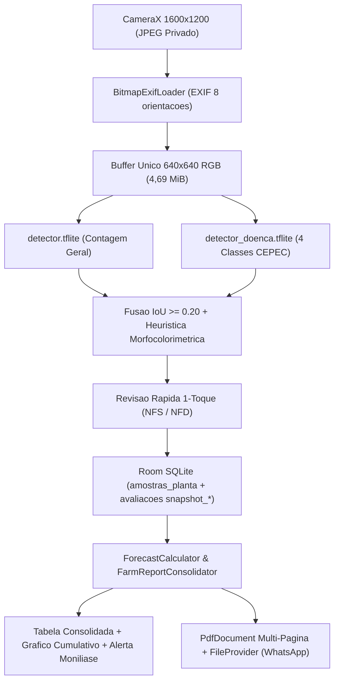

# CacauLens

[](https://github.com/Igor8818/cacao-forecast-ai/actions/workflows/android-ci.yml)


Aplicativo Android nativo (**Offline-First**, anteriormente codinome *CacaoForecastAI*) para previsão de safra em arrobas (`@`), monitoramento fitossanitário e alerta quarentenário de cacau com visão computacional embarcada (modelos TFLite CEPEC).

<details>
<summary>🇺🇸 <strong>Read in English — Executive Summary for Tech Recruiters &amp; Engineering Teams</strong></summary>

**CacauLens** is a production-grade, **100% offline-first native Android application** (`Kotlin 2.0.21`, `Jetpack Compose Material 3`, `Room SQLite`, `CameraX 1.5.3`, `TensorFlow Lite 2.16.1`) built for cacao harvest forecasting and phytosanitary risk monitoring in the field.

- **Field-Ready Ergonomics &amp; Onboarding:** High-contrast solar design system (`tnum` tabular numerals, bordered cards, adaptive launcher icon), 3-step onboarding, interactive agronomic glossary (`NPT/FA/NPF`), one-tap clone/spacing presets, guided camera reticle with haptics, and accessible bounding-box tags (`S/PP/MO/VB`).
- **Resilient Field Sampling (`1..NPF`):** Atomic per-plant persistence in SQLite (`IN_PROGRESS` → `COMPLETED`) allows instant session recovery after battery loss or OS process death, keeping temporary photos isolated in private storage and purging them upon completion.
- **Dual On-Device Computer Vision Pipeline:** Dedicated single-thread executor (`cacao-ml-worker`) with a shared `640×640` `DirectByteBuffer` executing `detector.tflite` (fruit counting) and `detector_doenca.tflite` (`PodridaoParda`, `Moniliase`, `Sadio`, `VassouraBruxa`), plus morpho-colorimetric refinement and `IoU >= 0.20` fusion.
- **Agronomic Math &amp; Historical Snapshots:** Computes both **Gross Biological Potential (`NFT`)** and **Net Marketable Harvest (`NFS`)**, prevents `NaN` on zero-fruit off-season plots, deduplicates intra-month evaluations per plot, freezes historical plot parameters (`snapshot_*`), and flags quarantine alerts upon any `Monilíase` detection.
- **Reporting, Calibration &amp; Backup:** Native multi-page `PdfDocument` generator with mandatory disclaimer footer and one-tap WhatsApp sharing (`FileProvider`), Excel-ready `.csv` research export (UTF-8 BOM), post-harvest `Estimated vs. Real (@)` cumulative chart, and integrity-checked SQLite backup/restore (`PRAGMA wal_checkpoint(FULL)` + `PRAGMA integrity_check` + automatic rollback).
- **Verified Quality:** **53 JVM + Robolectric unit tests across 13 suites** running automatically on GitHub Actions (`Android CI`).

</details>

---

## Arquitetura do Pipeline Offline-First



## Principais Capacidades
- **Gestão Hierárquica Offline:** Cadastro e arquivamento seguro (*soft delete*) de Fazendas e Roças / Quadras (`Área ha`, `NPT`, `FA`, `NPF`) persistidos no Room (`SQLite`).
- **Amostragem Resiliente em Campo (`1..NPF`):** Captura via CameraX (`1600x1200`) ou importação de foto da Galeria (modo laboratório/teste) em armazenamento privado, retomada automática de sessões `IN_PROGRESS` após queda de bateria/processo, trava de finalização antes de `NPF/NPF` e revisão manual com seletor individual das 3 doenças (`Podridão Parda`, `Monilíase`, `Vassoura de Bruxa`).
- **Inferência Dupla TFLite CEPEC:** Thread dedicada (`cacao-ml-worker`) e buffer `640x640` compartilhado executando `detector.tflite` (contagem geral) + `detector_doenca.tflite` (`PodridaoParda`, `Moniliase`, `Sadio`, `VassouraBruxa`), refinamento morfocolorimétrico e fusão IoU (`0.20f`).
- **Motor Matemático & Relatórios Consolidados:** Produção Bruta (`NFT`), Produção Líquida Sadia (`NFS`), semáforo fitossanitário, alerta quarentenário automático de Monilíase, deduplicação por quadra no período e ponderação consolidada por área e arrobas.
- **Evolução Cumulativa & Manejo:** Gráfico temporal nativo (`Estimada vs. Real @`), erro relativo médio pós-colheita e comparativo de manejo (`Δ p.p.` de perdas entre avaliações).
- **PDF Multi-Página, Planilha CSV & WhatsApp:** Geração nativa com `PdfDocument`, paginação automática, `Disclaimer` obrigatório em todas as páginas, exportação `.csv` para Excel/R/Python (UTF-8 BOM) e compartilhamento direto via `FileProvider`.
- **Backup / Restauração SQLite:** Exportação após `PRAGMA wal_checkpoint(FULL)` e importação validada (`PRAGMA integrity_check`, `user_version`, tabelas obrigatórias e rollback automático).

## Stack Técnica
- **Linguagem / UI:** Kotlin `2.0.21`, Jetpack Compose (Material 3), Navigation Compose `2.8.5`
- **Build / SDK:** AGP `8.9.1`, Gradle `8.11.1`, KSP `2.0.21-1.0.28`, `minSdk = 26`, `compileSdk = 35`, `targetSdk = 35`
- **Persistência & ML:** Room `2.6.1`, CameraX `1.5.3`, TensorFlow Lite `2.16.1`, ExifInterface `1.3.7`
- **Testes:** JUnit 4, Kotlinx Coroutines Test `1.9.0`, Robolectric `4.14.1`, Room Testing

## Suíte de Testes Automatizados (53 Testes em 13 Suítes)

| Camada | Suítes | Cobertura Principal |
| :--- | :---: | :--- |
| **Domínio & Matemática** | 4 suítes (`24` testes) | Fórmulas `NFT`/`NFS`, guarda `NFT == 0`, ponderação consolidada, curva cumulativa e presets agronômicos |
| **Room & Backup SQLite** | 2 suítes (`9` testes) | Snapshot histórico imutável, isolamento `IN_PROGRESS`, deduplicação mensal, soft delete, WAL checkpoint e rollback |
| **Visão Computacional & ML** | 3 suítes (`10` testes) | Decodificação YOLO `[1,5,8400]` / `[1,8,8400]`, NMS, fusão IoU `0.20`, heurística CEPEC, EXIF e headers `TFL3` |
| **ViewModels, PDF & CSV** | 4 suítes (`10` testes) | Sessão `1..NPF`, seletor das 3 doenças, CRUD/filtros, paginação PDF multi-página, alerta Monilíase, exportação `.csv` e WhatsApp |

## Build e Verificação Local

**Linux / macOS:**
```bash
./gradlew testDebugUnitTest assembleDebug assembleRelease
```

**Windows (PowerShell):**
```powershell
.\gradlew.bat testDebugUnitTest assembleDebug assembleRelease
```

Consulte [PLAN.md](PLAN.md) para o blueprint arquitetural completo e o detalhamento das tarefas `TASK-01` a `TASK-10`.
